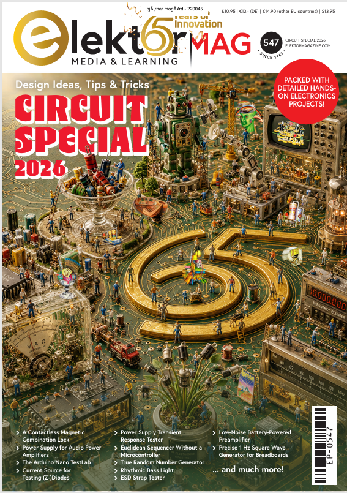
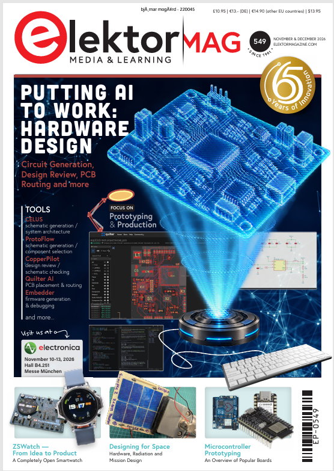

# 🚀 Official Engineering Correction: Elektor Magazine (2026)

This repository documents an official technical correction regarding the *"Rhythmic Bass Light"* circuit in **Elektor Magazine**, where a printed 70 Hz cutoff frequency was verified through calculations to actually be approximately 724 Hz, later acknowledged by the editorial board.

---

## 🔍 The Discovered Errata: "Rhythmic Bass Light"

### 1. Original Publication & Error

### 2. My Mathematical Analysis & Verification
Using the circuit's fixed feedback resistance ($R_3 = 22\text{ k}\Omega$) and filter capacitor ($C_3 = 10\text{ nF}$), the active inverting filter formula yields $F_c \approx 724\text{ Hz}$ rather than the printed 70 Hz.

---

## 🏆 Official Editorial Approval & Publication

> *"Thanks for your report. Indeed, it's a typo. The indicated component values are correct: The text should have reported '≈ 700 Hz'."*  
> — **Roberto Armani**, Editor-in-Chief, Elektor Magazine

**Reported and documented by:**  
Bjørnar Mogård (Norway)  
*Hardware Integrity & Electronics Review*
